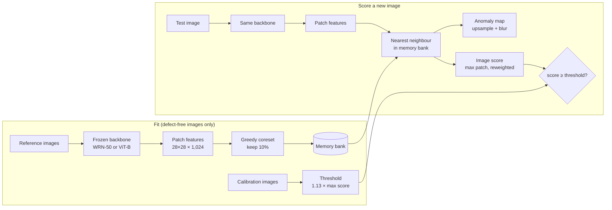

# VisionGuard

[](https://github.com/NullInTheHead/visionguard/actions/workflows/ci.yml)

**Industrial anomaly detection under distribution shift.** Under which kinds of shift does a
pretrained-feature detector keep working, and how few reference images does it need to
recover on a product it has never seen?

> Status: **M1 reached** (working baseline, v0.1). Next: the generalization study (Phase 3).

## Results so far: E1 baseline (WideResNet-50, development categories)

Our PatchCore, 10% coreset, memory bank from 90% of each category's defect-free training
images (the other 10% are held back for setting a threshold).

These are the ten **development** categories, which were also used to choose settings, so
this is a validated baseline, not yet evidence of generalization. The independent tests are
the five held-out categories (carpet, grid, hazelnut, screw, transistor), evaluated next
with every setting frozen.

| Category | Image AUROC | Pixel AUROC | AU-PRO | FPR @ 95% recall (oracle) | Recall at m, in-sample¹ | Recall at m, leave-one-out² |
|---|---|---|---|---|---|---|
| leather | 1.000 | 0.993 | 0.970 | 0.000 | 1.000 | 1.000 |
| tile | 0.995 | 0.959 | 0.809 | 0.000 | 0.667 | 0.667 |
| wood | 0.989 | 0.950 | 0.876 | 0.053 | 0.833 | 0.833 |
| bottle | 1.000 | 0.986 | 0.947 | 0.000 | 1.000 | 1.000 |
| cable | 0.993 | 0.985 | 0.934 | 0.034 | 0.761 | 0.761 |
| capsule | 0.980 | 0.988 | 0.928 | 0.087 | 0.651 | 0.651 |
| metal_nut | 0.999 | 0.985 | 0.937 | 0.000 | 0.914 | 0.914 |
| pill | 0.958 | 0.975 | 0.944 | 0.269 | 0.518 | 0.518 |
| toothbrush | 0.997 | 0.987 | 0.884 | 0.000 | 0.967 | 0.967 |
| zipper | 0.996 | 0.988 | 0.952 | 0.031 | 0.958 | 0.958 |
| **Mean** | **0.991** | **0.980** | **0.918** | **0.047** | **0.827** | **0.827** |

¹ Threshold set without seeing any defect: (1 + m) × the highest score among the held-back
defect-free images, with one margin m = 0.13 tuned on these same categories (target: at
most 1% of good parts rejected on average). Because m was tuned here, this column is a
tuning diagnostic. ² m chosen on the other nine categories, then applied to this one: an
out-of-sample estimate (mean false-reject rate 1.25% instead of 0.3%).

* **Benchmark scores are near-perfect, deployable performance is not.** At a threshold
  that rejects about 1% of good parts, the detector catches 83% of defects on average, and
  only 52% on pill and 65% on capsule, even though mean image AUROC is 0.991. The
  leave-one-out estimate gives the same recall, so this is not an artefact of tuning m on
  these categories. FPR @ 95% recall looks better only because it picks its threshold with
  the test labels.
* **Pill is the weakest category.** Catching 95% of defective pills would also reject 27%
  of good ones. The missed defects are mostly cracks on the pill's rim.
* **Some misses are a preprocessing artefact.** On tile, two of the four lowest-scoring
  defects lie almost entirely outside the 224-pixel centre crop (see
  `results/data/defect_images.csv`).

Heatmaps for every category are in [`results/e1/heatmaps/`](results/e1/heatmaps): top
row highest-scoring defects, middle row highest-scoring good parts, bottom row misses.


**Check against anomalib 2.7** (same settings, every training image in the memory bank):

| Category | Image AUROC (ours / anomalib) | Pixel AUROC (ours / anomalib) | AU-PRO (ours / anomalib) |
|---|---|---|---|
| bottle | 1.000 / 1.000 | 0.986 / 0.981 | 0.947 / 0.929 |
| capsule | 0.981 / 0.977 | 0.988 / 0.988 | 0.930 / 0.920 |

Image and pixel AUROC agree within 0.5 points; our AU-PRO is 1-2 points higher. The two
implementations differ slightly in how they combine the two layers' features (see
`embed_patches` in `src/visionguard/patchcore.py`).

## How it works



No training: the detector only stores what normal looks like, and flags patches that are
far from everything it has stored.

## Research question

Visual inspection systems are usually fitted to one product under one camera setup. In a
factory, products change, lighting drifts and new lines are added. VisionGuard measures a
PatchCore-style detector under three separate kinds of shift:

| Experiment | Shift | Headline output |
|---|---|---|
| E1 | New defects on a familiar product | Per-category image AUROC, pixel AUROC, AU-PRO |
| E2 | Entirely new product (zero-shot and k-shot) | AUROC vs number of reference images |
| E3 | Image acquisition (blur, noise, lighting, JPEG) | AUROC vs corruption severity |

The full evaluation protocol, including the category split and leakage rules, is in
[`docs/protocol.md`](docs/protocol.md).

## Setup

Needs Python 3.10+. Use a virtual environment. On macOS, Homebrew and python.org Python
install the commands as `python3` and `pip3`, and Homebrew's Python refuses system-wide
`pip` installs (PEP 668); inside an activated environment, `python` and `pip` just work:

```bash
git clone https://github.com/NullInTheHead/visionguard.git
cd visionguard
python3 -m venv .venv && source .venv/bin/activate
pip install -e ".[dev]"            # data, metrics, tests (no torch needed)
pip install -e ".[models,dev]"     # + torch and timm for the experiments
pytest                             # runs on a synthetic dataset, no download needed
```

### Get MVTec AD (about 4.9 GB)

MVTec only serves the dataset through its website, so download it in a browser from the
[MVTec AD downloads page](https://www.mvtec.com/company/research/datasets/mvtec-ad/downloads)
(`mvtec_anomaly_detection.tar.xz`), then extract it:

```bash
bash scripts/setup_mvtec.sh ~/Downloads/mvtec_anomaly_detection.tar.xz data
# -> data/mvtec_anomaly_detection/<category>/{train,test,ground_truth}
```

**Kaggle (recommended GPU).** Upload the extracted `mvtec_anomaly_detection` folder once as
a private Kaggle dataset, attach it to a GPU notebook, then:

```python
!git clone https://github.com/NullInTheHead/visionguard.git
%cd visionguard
!pip install -q -e ".[models,dev]"
# pass --root /kaggle/input/<your-dataset>/mvtec_anomaly_detection to the scripts
```

**Colab.** Keep the `.tar.xz` in Google Drive and extract it to local disk at the start of
each session with `scripts/setup_mvtec.sh` (reading thousands of small files straight from
Drive is slow).

## Phase 1: inspect the data

```bash
python scripts/inspect_data.py --root data/mvtec_anomaly_detection --out results/data
```

Writes per-category and per-defect-type tables (counts, defect sizes, tiny defects, defects
lost to the centre crop, a check against the published counts) and sample grids with masks
overlaid to `results/data/`.

## Phase 2: PatchCore baseline (E1)

Our own PatchCore (`src/visionguard/patchcore.py`) on WideResNet-50, run on the 10
development categories:

```bash
pip install -e ".[models,dev]"
python scripts/run_e1.py                              # a few minutes per category on a GPU or Apple M-series
```

Results land in `results/e1/`: `metrics.csv` (one row per category, with the git commit
and package versions), per-image scores in `scores/`, and heatmap grids in `heatmaps/`
(highest-scoring defects, highest-scoring good parts, lowest-scoring defects).

**Check against anomalib.** Run anomalib's PatchCore with the same settings on two
categories, in its own environment (anomalib pins its own torch and lightning versions):

```bash
python -m venv .venv-anomalib && source .venv-anomalib/bin/activate
pip install "anomalib>=2.0,<3" pandas
python scripts/run_anomalib_reference.py --categories bottle capsule
deactivate && source .venv/bin/activate
python scripts/run_e1.py --categories bottle capsule --calibration-fraction 0
```

`--calibration-fraction 0` puts every training image in the memory bank, as anomalib
does. Image AUROC should agree within about 1-2 points. Held-out categories are refused
unless `--allow-held-out` is passed, which is only for runs with frozen settings.

**Deployable threshold.** `python scripts/choose_margin.py` picks the margin m from the
E1 scores (smallest m with at most 1% false rejects on average over the development
categories) and writes `results/e1/threshold_wrn50.csv` and `margin_sweep_wrn50.csv`.

## Repository layout

```
configs/            base.yaml, split.yaml (dev / held-out categories), one YAML per experiment
docs/protocol.md    evaluation protocol, written before any experiment
src/visionguard/
  data.py           MVTec index, preprocessing, calibration split, nested k-shot sampler
  data_report.py    dataset inventory and sample figures
  metrics.py        image/pixel AUROC, AU-PRO, FPR at 95% recall, fixed-threshold metrics
  features.py       frozen backbones (WRN-50, supervised / DINOv2 / CLIP ViT-B) behind one interface
  patchcore.py      patch embedding, greedy coreset, NN scoring, reweighting, smoothed maps
  experiment.py     metrics rows, CSV logging with run metadata, heatmap grids
  corruptions.py    acquisition-shift transforms (Phase 3)
scripts/            setup_mvtec.sh, inspect_data.py, run_e1.py, run_anomalib_reference.py, (run_e2.py, run_e3.py)
results/            CSVs and figures (committed)
tests/              unit tests on a synthetic MVTec tree
app/                demo (Phase 5)
```

## Data licence and attribution

MVTec AD is © MVTec Software GmbH, licensed under
[CC BY-NC-SA 4.0](https://creativecommons.org/licenses/by-nc-sa/4.0/) (non-commercial use).
The dataset is not included in this repository. If you use it, cite:

* P. Bergmann, M. Fauser, D. Sattlegger, C. Steger. *MVTec AD — A Comprehensive Real-World
  Dataset for Unsupervised Anomaly Detection.* CVPR 2019.
* P. Bergmann, K. Batzner, M. Fauser, D. Sattlegger, C. Steger. *The MVTec Anomaly
  Detection Dataset: A Comprehensive Real-World Dataset for Unsupervised Anomaly
  Detection.* IJCV 2021.

The code in this repository is MIT-licensed (see `LICENSE`).
