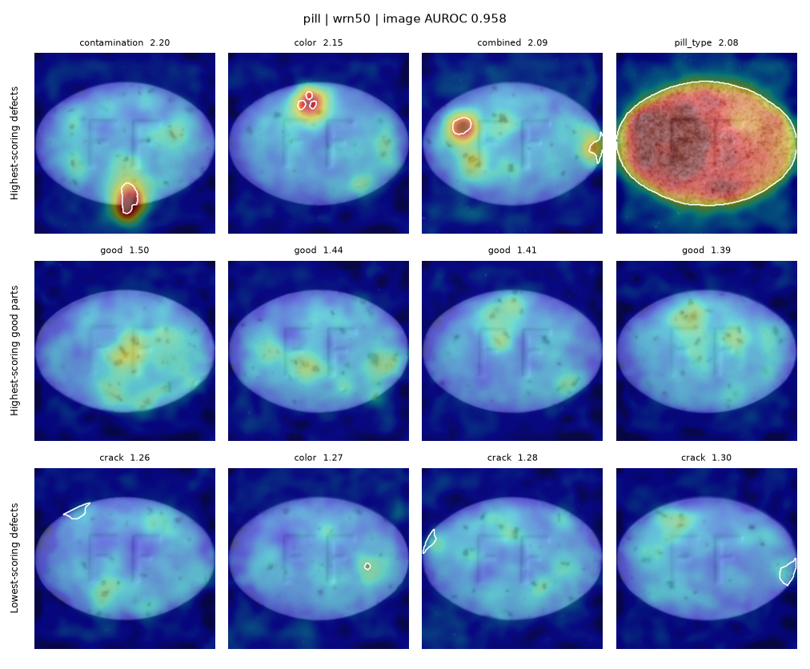
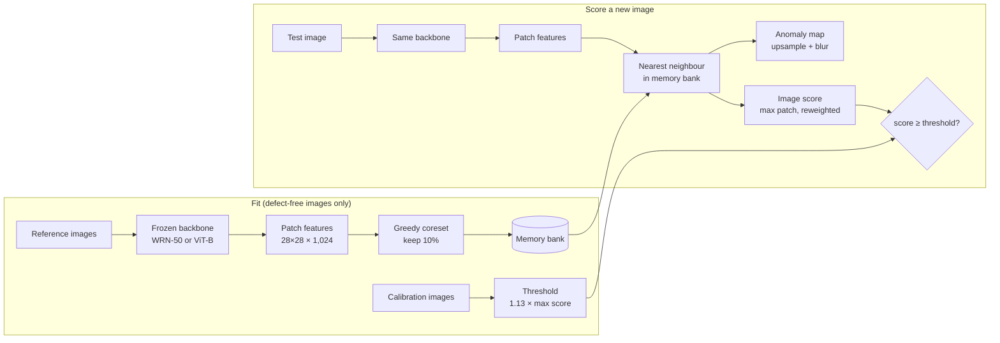

# VisionGuard

[](https://github.com/NullInTheHead/visionguard/actions/workflows/ci.yml)

**Industrial anomaly detection under distribution shift.** Under which kinds of shift does a
pretrained-feature detector keep working, and how few reference images does it need to
recover on a product it has never seen?

> Status: **M1 reached** (v0.1); Phase 3 under way. Protocol v1.4 sets the research
> questions; E2 (new products, zero-shot and few-shot) is next, then the other backbones.

## Results so far: E1 (WideResNet-50, in-category detection)

Our PatchCore, 10% coreset. Each category's memory bank comes from 90% of its own
defect-free training images; the other 10% are held back to set a threshold. This is E1:
the bank always comes from the same product, so these numbers test the detector and the
frozen settings, not transfer to unseen products (that is E2, next).

<!-- results:start (generated by scripts/make_tables.py; do not edit by hand) -->
### Development categories (used to choose settings)

| Category | Image AUROC | Pixel AUROC | AU-PRO | FPR @ 95% recall (oracle) | Recall at m | False rejects at m | Recall at m, leave-one-out |
|---|---|---|---|---|---|---|---|
| leather | 1.000 | 0.993 | 0.970 | 0.000 | 1.000 | 0.000 | 1.000 |
| tile | 0.995 | 0.959 | 0.809 | 0.000 | 0.667 | 0.000 | 0.667 |
| wood | 0.989 | 0.950 | 0.876 | 0.053 | 0.833 | 0.000 | 0.833 |
| bottle | 1.000 | 0.986 | 0.947 | 0.000 | 1.000 | 0.000 | 1.000 |
| cable | 0.993 | 0.985 | 0.934 | 0.034 | 0.761 | 0.000 | 0.761 |
| capsule | 0.980 | 0.988 | 0.928 | 0.087 | 0.651 | 0.000 | 0.651 |
| metal_nut | 0.999 | 0.985 | 0.937 | 0.000 | 0.914 | 0.000 | 0.914 |
| pill | 0.958 | 0.975 | 0.944 | 0.269 | 0.518 | 0.000 | 0.518 |
| toothbrush | 0.997 | 0.987 | 0.884 | 0.000 | 0.967 | 0.000 | 0.967 |
| zipper | 0.996 | 0.988 | 0.952 | 0.031 | 0.958 | 0.031 | 0.958 |
| **Mean** | **0.991** | **0.980** | **0.918** | **0.047** | **0.827** | **0.003** | **0.827** |

### Held-out categories (independent test, every setting frozen)

| Category | Image AUROC | Pixel AUROC | AU-PRO | FPR @ 95% recall (oracle) | Recall at m | False rejects at m |
|---|---|---|---|---|---|---|
| carpet | 0.985 | 0.990 | 0.946 | 0.036 | 0.955 | 0.143 |
| grid | 0.971 | 0.986 | 0.934 | 0.190 | 0.772 | 0.000 |
| hazelnut | 1.000 | 0.986 | 0.941 | 0.000 | 0.900 | 0.000 |
| screw | 0.975 | 0.993 | 0.961 | 0.122 | 0.546 | 0.000 |
| transistor | 1.000 | 0.962 | 0.928 | 0.000 | 0.825 | 0.000 |
| **Mean** | **0.986** | **0.983** | **0.942** | **0.070** | **0.800** | **0.029** |

m = 0.13: threshold = (1 + m) × the highest score among each category's held-back defect-free calibration images, so no defect is seen. m was tuned on the development categories, so their columns at m are tuning diagnostics; the leave-one-out column chooses m on the other nine development categories. On the held-out categories m is frozen, so those columns are an independent test.

### Check against anomalib 2.7 (same settings, every training image as reference)

| Category | Image AUROC (ours / anomalib) | Pixel AUROC (ours / anomalib) | AU-PRO (ours / anomalib) |
|---|---|---|---|
| bottle | 1.000 / 1.000 | 0.986 / 0.981 | 0.947 / 0.929 |
| capsule | 0.981 / 0.977 | 0.988 / 0.988 | 0.930 / 0.920 |
<!-- results:end -->

**What E1 shows**

* **The frozen settings hold up on new categories.** Held-out mean image AUROC is 0.986
  (development 0.991) and AU-PRO 0.942 (development 0.918). Grid and screw are the
  weakest held-out categories: catching 95% of their defects would also reject 19% and
  12% of good parts.
* **Benchmark scores are near-perfect, deployable performance is not.** With a threshold
  set without seeing any defect, the detector catches 83% of defects on development
  categories and 80% on held-out ones, even though image AUROC is about 0.99. Screw (55%)
  and pill (52%) are the worst. FPR @ 95% recall looks better only because it picks its
  threshold with the test labels.
* **The threshold rule does not transfer reliably.** The margin m keeps false rejects at
  0.3% on the development categories it was tuned on (1.25% leave-one-out), but on the
  held-out categories carpet rejects 14% of good parts, so the held-out average is 2.9%.
  With only 20-40 calibration images per product, their maximum score can underestimate
  how high a normal part can score.
* **Some misses are explainable.** Missed pill defects are mostly cracks on the rim, and
  on tile two of the four lowest-scoring defects lie almost entirely outside the
  224-pixel centre crop (see `results/data/defect_images.csv`).
* **Our PatchCore matches anomalib.** Image and pixel AUROC agree within 0.5 points; our
  AU-PRO is 1-2 points higher. The two implementations differ slightly in how they
  combine the two layers' features (see `embed_patches` in
  `src/visionguard/patchcore.py`). The comparison runs predate the current coreset code;
  rerunning E1 with it changed no metric by more than 0.0001.

Heatmaps for every category are in [`results/e1/heatmaps/`](results/e1/heatmaps) (top
row highest-scoring defects, middle row highest-scoring good parts, bottom row misses), and
image / ground truth / heatmap panels in [`results/e1/examples/`](results/e1/examples).



## How it works



No training: the detector only stores what normal looks like, and flags patches that are
far from everything it has stored.

## Research question

Visual inspection systems are usually fitted to one product under one camera setup. In a
factory, products change, lighting drifts and new lines are added. VisionGuard measures a
PatchCore-style detector under three separate kinds of shift:

| Experiment | Shift | Headline output |
|---|---|---|
| E1 | New defects on a familiar product | Per-category image AUROC, pixel AUROC, AU-PRO |
| E2 | Entirely new product (zero-shot and k-shot) | AUROC vs number of reference images |
| E3 | Image acquisition (blur, noise, lighting, JPEG) | AUROC vs corruption severity |

The full evaluation protocol, including the category split and leakage rules, is in
[`docs/protocol.md`](docs/protocol.md).

## Setup

Needs Python 3.10+. Use a virtual environment. On macOS, Homebrew and python.org Python
install the commands as `python3` and `pip3`, and Homebrew's Python refuses system-wide
`pip` installs (PEP 668); inside an activated environment, `python` and `pip` just work:

```bash
git clone https://github.com/NullInTheHead/visionguard.git
cd visionguard
python3 -m venv .venv && source .venv/bin/activate
pip install -e ".[dev]"            # data, metrics, tests (no torch needed)
pip install -e ".[models,dev]"     # + torch and timm for the experiments
pytest                             # runs on a synthetic dataset, no download needed
```

### Get MVTec AD (about 4.9 GB)

MVTec only serves the dataset through its website, so download it in a browser from the
[MVTec AD downloads page](https://www.mvtec.com/company/research/datasets/mvtec-ad/downloads)
(`mvtec_anomaly_detection.tar.xz`), then extract it:

```bash
bash scripts/setup_mvtec.sh ~/Downloads/mvtec_anomaly_detection.tar.xz data
# -> data/mvtec_anomaly_detection/<category>/{train,test,ground_truth}
```

**Kaggle (recommended GPU).** Upload the extracted `mvtec_anomaly_detection` folder once as
a private Kaggle dataset, attach it to a GPU notebook, then:

```python
!git clone https://github.com/NullInTheHead/visionguard.git
%cd visionguard
!pip install -q -e ".[models,dev]"
# pass --root /kaggle/input/<your-dataset>/mvtec_anomaly_detection to the scripts
```

**Colab.** Keep the `.tar.xz` in Google Drive and extract it to local disk at the start of
each session with `scripts/setup_mvtec.sh` (reading thousands of small files straight from
Drive is slow).

## Phase 1: inspect the data

```bash
python scripts/inspect_data.py --root data/mvtec_anomaly_detection --out results/data
```

Writes per-category and per-defect-type tables (counts, defect sizes, tiny defects, defects
lost to the centre crop, a check against the published counts) and sample grids with masks
overlaid to `results/data/`.

## Phase 2: PatchCore baseline (E1)

Our own PatchCore (`src/visionguard/patchcore.py`) on WideResNet-50, run on the 10
development categories:

```bash
pip install -e ".[models,dev]"
python scripts/run_e1.py                              # a few minutes per category on a GPU or Apple M-series
```

Results land in `results/e1/`: `metrics.csv` (one row per category, with the git commit
and package versions), per-image scores in `scores/`, and heatmap grids in `heatmaps/`
(highest-scoring defects, highest-scoring good parts, lowest-scoring defects).

**Check against anomalib.** Run anomalib's PatchCore with the same settings on two
categories, in its own environment (anomalib pins its own torch and lightning versions):

```bash
python -m venv .venv-anomalib && source .venv-anomalib/bin/activate
pip install "anomalib>=2.0,<3" pandas
python scripts/run_anomalib_reference.py --categories bottle capsule
deactivate && source .venv/bin/activate
python scripts/run_e1.py --categories bottle capsule --calibration-fraction 0
```

`--calibration-fraction 0` puts every training image in the memory bank, as anomalib
does. Image AUROC should agree within about 1-2 points. Held-out categories are refused
unless `--allow-held-out` is passed, which is only for runs with frozen settings.

**Deployable threshold.** `python scripts/choose_margin.py` picks the margin m from the
development categories' E1 scores (smallest m with at most 1% false rejects on average;
now frozen at 0.13 in `configs/base.yaml`) and reports a leave-one-category-out estimate.
`python scripts/apply_threshold.py` applies the frozen m to the held-out categories.
`python scripts/make_tables.py` regenerates the README results tables from the CSVs.

## Phase 3: new products (E2)

Zero-shot and few-shot detection on the five held-out products, with every setting frozen:

```bash
python scripts/run_e2.py
```

* **E2a, zero-shot (k = 0):** one memory bank made of the 10 development products'
  coresets, nothing from the target. The coresets are cached in `cache/banks/`, so the
  first run builds them and later runs reuse them.
* **E2b, few-shot (k = 1, 2, 4, 8):** every patch of k defect-free images of the target,
  5 seeds each, nested draws.

Each test set is embedded once and scored against all 21 banks. Results land in
`results/e2/`: `metrics.csv` (one row per bank, with timings and memory), per-image scores
in `scores/`, and recovery curves `recovery_wrn50_image_auroc.png` and
`recovery_wrn50_au_pro.png`, with the E1 result as the k = all reference line.

**E2c, rotation diagnostic (post-hoc, protocol section 16.1).** Few-shot screw stays near
chance and few-shot grid drops below zero-shot. E2c tests whether pose variation is the
cause, by adding rotated copies of the k reference images to the bank:

```bash
python scripts/run_e2.py --rotations rot90
python scripts/run_e2.py --rotations rot45
```

The design and per-product predictions were committed before any run. Results go to the
same `metrics.csv` (experiments `e2c-rot90`, `e2c-rot45`), scores to
`scores/<backbone>_<category>_<rotations>.csv`, and the comparison to
`rotation_wrn50_image_auroc.png`.

Every run also logs the efficiency measurements of protocol section 13: feature-extraction,
nearest-neighbour and post-processing time per image, memory-bank size and peak memory.

## Phase 3: deployable thresholds (RQ2)

Every calibration rule assumes that held-back defect-free *training* images behave like
defect-free *test* images. The first check of that assumption, from the E1 scores:

```bash
python scripts/threshold_analysis.py
```

**Result: they often do not.** On the development categories, 13.0% of defect-free test
images score above the calibration maximum, against 4.6% expected if the two were
interchangeable, and test goods score significantly higher in 4 of 10 products (leather:
47% above the maximum). See `results/thresholds/exchangeability_wrn50.png`.

Next, a diagnostic that separates the two possible causes, near-twin training images or
a change in capture conditions between training and test (protocol section 11.1):

```bash
python scripts/calibration_diagnostic.py
```

**Result: drift, not twins.** Holding back a contiguous block of training images instead
of a random 10% does not close the gap, and test goods sit 3-4x farther from their
nearest training image than calibration images do in leather and wood
(`results/thresholds/calibration_diagnostic_wrn50.csv`).

So the fix has to come from the deployment side: *calibrate where you deploy*. Half of
each product's defect-free test images serve as a deployment calibration set, the other
half are scored, over 1,000 random splits, and four rules are compared (protocol section
11.2, predictions registered before the run):

```bash
python scripts/deployment_calibration.py
```

| at alpha = 10% | exceeds alpha (dev / held-out) |
|---|---|
| training conformal, mean over splits | 6 of 9 / 3 of 5 |
| training conformal, beyond chance (exact beta-binomial test, p < 0.05) | 2 of 9 (leather, wood) / 2 of 5 (carpet, screw) |
| deployment conformal | **0 of 9 / 0 of 5** |

* Deployment conformal lands on its exact expected rate in every product, including the
  held-out ones, so the false-reject rate is predictable without seeing the product's
  test distribution in advance, only a small sample of its good parts.
* The guarantee is an average over calibration sets: in about a quarter of single draws
  the realised rate is above 10%, so a single deployment should report it with its
  spread, not as a bound.
* The price is recall where drift was large: pill 0.93 to 0.84, screw 0.99 to 0.87,
  carpet 1.00 to 0.93.
* The max + margin rules almost never reject a good part, and pay for it in recall.

See `results/thresholds/deployment_calibration_wrn50.png`.

Could more *training* calibration images fix it instead? Holding back 10%, 25% or 50% of
the training images (3 random draws each, development categories):

```bash
python scripts/calibration_size.py
```

| held back for calibration | 10% | 25% | 50% |
|---|---|---|---|
| image AUROC (mean) | 0.990 | 0.989 | 0.988 |
| leather / wood beyond chance at alpha = 10% (seeds) | 3/3, 3/3 | 3/3, 3/3 | 3/3, 3/3 |
| products without drift beyond chance (cells) | 0 of 15 | 0 of 18 | 0 of 18 |
| max + margin recall | 0.79 | 0.73 | 0.66 |

Halving the memory bank costs almost no ranking and makes a 1% target possible, but
drifted products stay drifted: calibration has to come from the deployment session.
See `results/thresholds/calibration_size_wrn50.png`.

Last, can a fitted tail (extreme-value theory) reach small targets that conformal cannot?

```bash
python scripts/evt_analysis.py           # tail fit on training calibration images
```

No. With about 113 training calibration images on products without drift, it gives 2.4%
false rejects at a 1% target, where split conformal gives 0.7%; on deployment images it
lands at 3-4x a 1% target. Small targets need more calibration images, not
extrapolation (protocol section 11.4).

## Clean test on VisA (in progress)

Every RQ2 conclusion above was reached on MVTec AD. VisA (12 products, never looked at) is
the clean test: the same frozen settings, the same scripts, and predictions recorded in
`docs/protocol.md` (section 11.5) before any VisA image was loaded.

```bash
bash scripts/setup_visa.sh                       # download (1.8 GB), MVTec layout in data/visa
python scripts/run_e1.py --config configs/e1_visa.yaml --allow-held-out
python scripts/threshold_analysis.py --split configs/split_visa.yaml \
    --scores results/visa/e1/scores --out results/visa/thresholds
python scripts/deployment_calibration.py --config configs/e1_visa.yaml \
    --scores results/visa/e1/scores --out results/visa/thresholds
```

## Repository layout

```
configs/            base.yaml, split.yaml (dev / held-out categories), one YAML per experiment
docs/protocol.md    evaluation protocol, written before any experiment
src/visionguard/
  data.py           MVTec index, preprocessing, calibration split, nested k-shot sampler
  data_report.py    dataset inventory and sample figures
  metrics.py        image/pixel AUROC, AU-PRO, FPR at 95% recall, fixed-threshold metrics
  features.py       frozen backbones (WRN-50, supervised / DINOv2 / CLIP ViT-B) behind one interface
  patchcore.py      patch embedding, greedy coreset, NN scoring, reweighting, smoothed maps
  experiment.py     metrics rows, CSV logging with run metadata, heatmap grids, E2 curves
  banks.py          cached coresets, the shared zero-shot bank, few-shot draws
  corruptions.py    acquisition-shift transforms (Phase 3)
scripts/            setup_mvtec.sh, inspect_data.py, run_e1.py, run_anomalib_reference.py,
                    choose_margin.py, apply_threshold.py, make_tables.py, run_e2.py,
                    threshold_analysis.py, calibration_diagnostic.py,
                    deployment_calibration.py, calibration_size.py, evt_analysis.py,
                    setup_visa.sh, prepare_visa.py, (run_e3.py)
results/            CSVs and figures (committed)
tests/              unit tests on a synthetic MVTec tree
app/                demo (Phase 5)
```

## Data licence and attribution

MVTec AD is © MVTec Software GmbH, licensed under
[CC BY-NC-SA 4.0](https://creativecommons.org/licenses/by-nc-sa/4.0/) (non-commercial use).
The dataset is not included in this repository. If you use it, cite:

* P. Bergmann, M. Fauser, D. Sattlegger, C. Steger. *MVTec AD — A Comprehensive Real-World
  Dataset for Unsupervised Anomaly Detection.* CVPR 2019.
* P. Bergmann, K. Batzner, M. Fauser, D. Sattlegger, C. Steger. *The MVTec Anomaly
  Detection Dataset: A Comprehensive Real-World Dataset for Unsupervised Anomaly
  Detection.* IJCV 2021.

VisA is © Amazon.com, Inc., licensed under
[CC BY 4.0](https://creativecommons.org/licenses/by/4.0/); not included here either.
`configs/visa_split_1cls.csv` is the authors' official split, copied unchanged from
[amazon-science/spot-diff](https://github.com/amazon-science/spot-diff). Cite:

* Y. Zou, J. Jeong, L. Pemula, D. Zhang, O. Dabeer. *SPot-the-Difference Self-Supervised
  Pre-training for Anomaly Detection and Segmentation.* ECCV 2022.

The code in this repository is MIT-licensed (see `LICENSE`).
